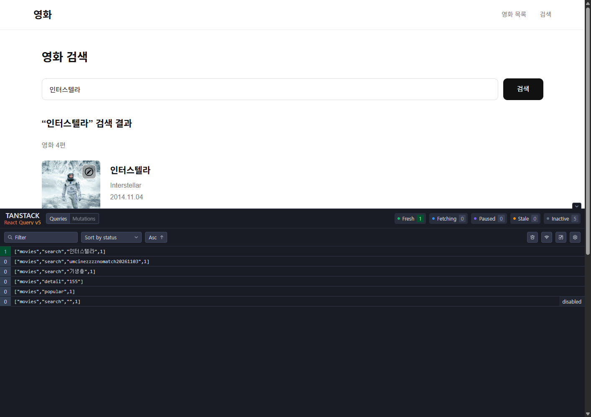
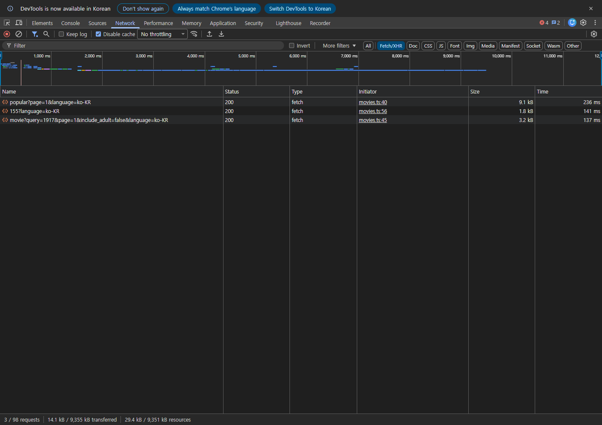

# TanStack Query 검증 기록

확인 날짜: 2026-11-03

`pnpm type-check`, `pnpm test`(19개), `pnpm build`가 모두 통과했습니다. API·Query 테스트는 모의 응답으로 오류·취소·캐시 분리를 검증하며, 아래 브라우저 검증은 실제 TMDB 응답을 사용했습니다.

Chrome의 개발 모드 화면에서 목록·검색·상세 성공, 빈 검색 요청 차단, 검색 빈 결과, 네트워크 차단 오류, 차단 해제 후 재시도 복구, 잘못된 상세 ID의 요청 차단을 확인했습니다. 처리되지 않은 브라우저 예외는 없었습니다.

| 실제 브라우저 이동 | 이동 전 누적 TMDB GET | 재방문 후 누적 TMDB GET |
| --- | ---: | ---: |
| 목록 → 상세 → 목록 → 같은 상세 | 2 | 2 |
| 검색 → 목록 → 뒤로 가기로 같은 검색 | 3 | 3 |

첫 요청의 응답이 완료된 후 5분 안에 앱 내부에서 이동했습니다. CORS 사전 요청인 OPTIONS는 GET 수에서 제외했습니다. Network 이벤트는 Chrome DevTools Protocol로 수집했으며 인증 헤더와 API 키는 기록하지 않았습니다.

앱의 QueryClient와 queryOptions를 실제 TMDB에 연결한 별도 검증에서도 목록 20개, `1917` 검색, 영화 `155` 상세가 모두 HTTP 200을 반환했습니다. 같은 키로 다시 조회할 때 누적 요청 수는 각각 1→1, 2→2, 3→3으로 유지됐습니다.

Query Devtools에서 현재 검색은 Fresh 1 / Fetching 0으로 표시되었고, 이전 목록·상세·검색은 Inactive 캐시에 남았습니다. 빈 검색어 쿼리는 disabled였습니다.

Chrome의 **Network 패널 → Fetch/XHR**에서도 목록·상세·검색의 GET 3건, HTTP 200과 `movies.ts` Initiator를 직접 확인했습니다. **Disable cache**를 켜서 브라우저의 HTTP 캐시와 구분했고, 세 요청 모두 실제 네트워크 응답을 받았습니다.

세부 브라우저 결과와 Network 이벤트는 [browser-report.json](query-verification/browser-report.json)에 저장했습니다. 직접 따라 할 수 있는 Devtools·Network 패널 확인 절차는 [README](../README.md#tanstack-query와-캐시-확인)에 있습니다.

캐시는 메모리에 보관됩니다. 새로고침하면 초기화되며, 5분이 지난 캐시는 재방문 시 백그라운드에서 갱신합니다. 화면에서 구독하지 않는 캐시는 30분 후 정리됩니다.
